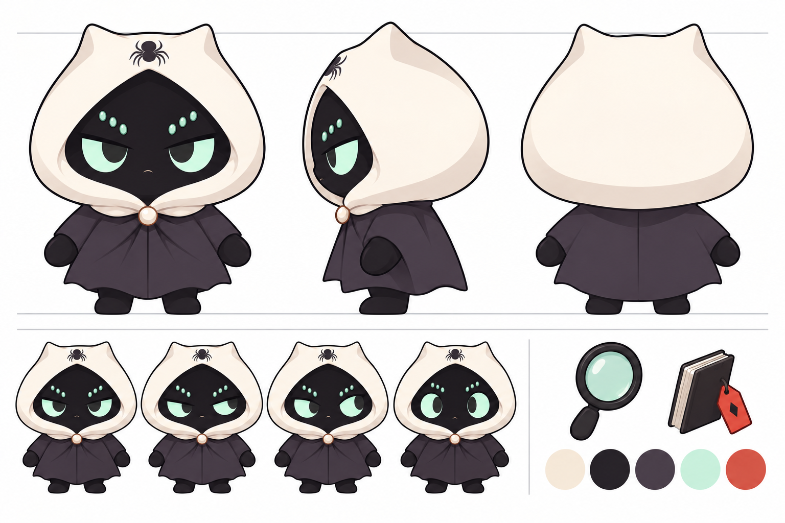
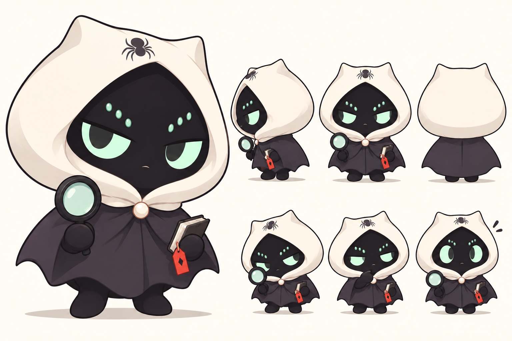

# IP Studio · 蜘蛛侦探

严肃萌风格的原创蜘蛛侦探 IP 设计资料，当前版本 **v1.0**。

## 设计规范

[阅读完整 IP 设计规范](./IP设计规范-v1.0.md)：角色定位、标准三视图、比例、标准色、表情、道具及使用规则。

蜘蛛识别特征限定为 **六颗副眼与帽顶蜘蛛标记**；保留双手双脚、奶白兜帽和纯色墨紫斗篷，不使用大面积蛛网。

## 标准设定图

## 已确认概念方向

视觉设定图由图像生成工具制作，用作设计参考。后续矢量定稿及生产制作，以规范文档中的比例和色值为准。
